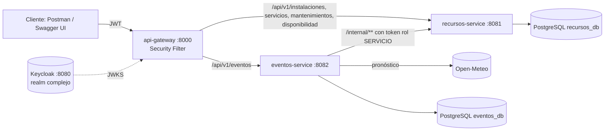
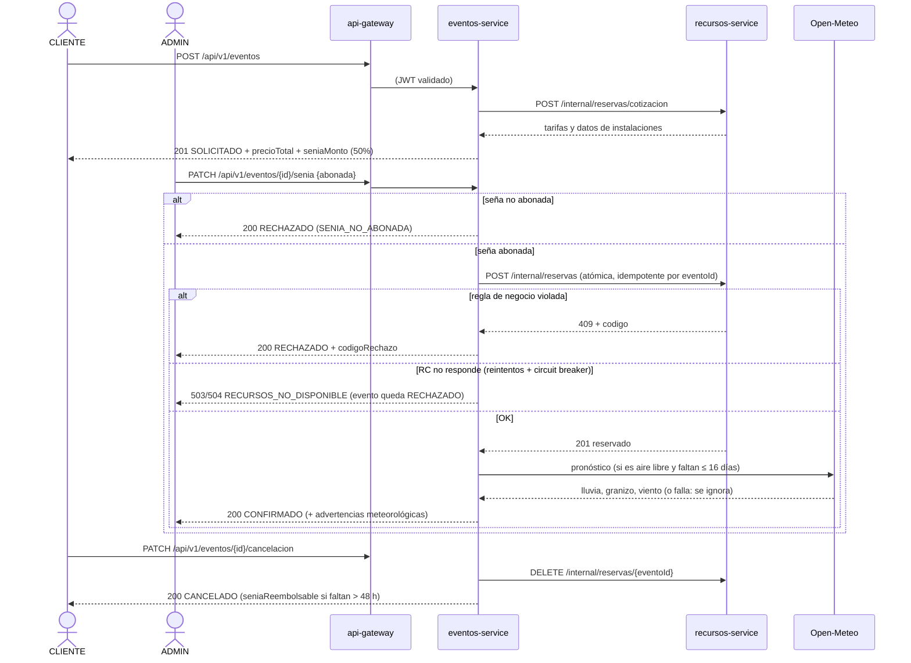
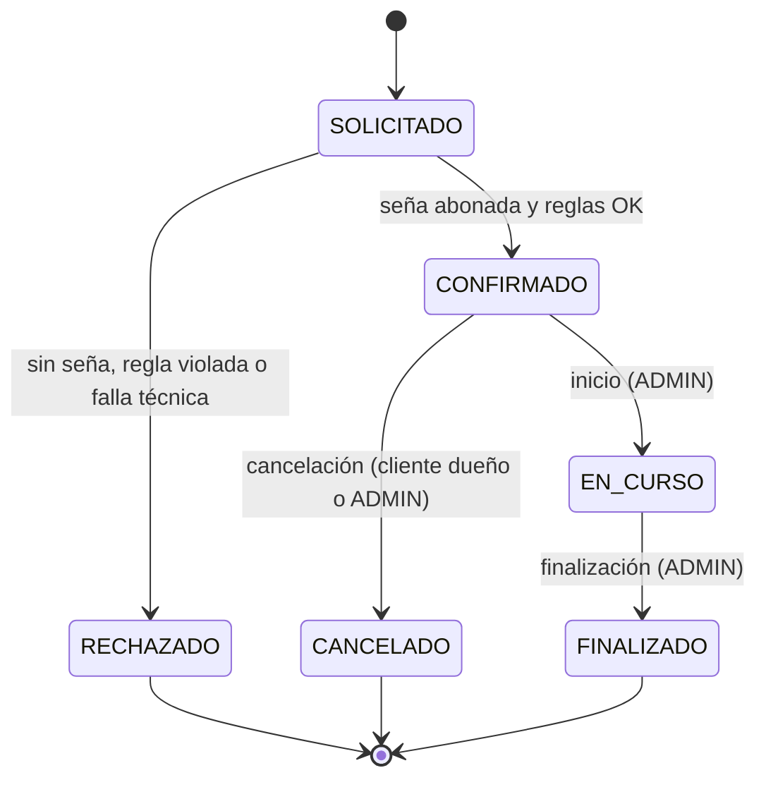

# Documentación técnica — Gestión de eventos en un complejo multiusos

Complementa y corrige la "Documentación Programa Gestión de eventos". Donde haya diferencias con ese documento, **vale este**.

## 1. Arquitectura



- Solo `api-gateway` (8000) y `keycloak` (8080) publican puertos; el resto vive en la red de Compose (zona de confianza).
- El Gateway valida el JWT, aplica la matriz de permisos (sección 3) y **no tiene ruta** hacia `/internal/**` (devuelve 404). Los servicios revalidan el JWT (defensa en profundidad).
- `common-library` (JAR instalado en `.m2`) la usan los tres módulos: errores estándar (`ApiError`, `BusinessException`), intervalos/tiempo (zona America/Argentina/Cordoba) y conversor de roles de Keycloak (`realm_access.roles` → `ROLE_*`). No contiene lógica de dominio.
- Roles: `ADMIN`, `CLIENTE` (usuarios) y `SERVICIO` (cuenta técnica `eventos-service`, client credentials, única autorizada en `/internal/**`).

## 2. Flujo central: solicitar, confirmar y cancelar



La seña es una **condición para pasar de SOLICITADO a CONFIRMADO**; se valida junto con las demás reglas. Sin seña, SOLICITADO → RECHAZADO.

## 3. Estados del evento



Cualquier otra transición responde 409 `TRANSICION_INVALIDA`. No se cancela un evento EN_CURSO. Reprogramar = cancelar y crear uno nuevo. Cada cambio queda en `historial_estado_evento`.

## 4. Reglas de negocio y códigos de rechazo

| # | Regla | `codigoRechazo` |
|---|---|---|
| 1 | Anticipación mínima de 48 h | `ANTICIPACION_INSUFICIENTE` |
| 2 | Sin solapamiento en la misma instalación (todo-o-nada en eventos multiespacio) | `CONFLICTO_DISPONIBILIDAD` |
| 3 | Asistentes ≤ capacidad (se suman las capacidades de las instalaciones) | `CAPACIDAD_EXCEDIDA` |
| 4 | Dentro del horario de cada instalación, evento de un solo día | `FUERA_DE_HORARIO` |
| 5 | Instalación sin mantenimiento activo en la franja | `MANTENIMIENTO` |
| 6 | Stock de servicios complementarios por fecha | `STOCK_INSUFICIENTE` |
| 7 | Seña abonada (50% del total) | `SENIA_NO_ABONADA` |

Precio = tarifa fija de $10.000/hora × horas facturables (redondeo hacia arriba) por instalación + servicios (precio × cantidad). Sin recargos por feriado o fin de semana.
Pronóstico adverso (solo instalaciones al aire libre, eventos a ≤ 16 días): lluvia > 40%, granizo (códigos WMO 96/99) o ráfagas ≥ 50 km/h. Genera **advertencia**, no rechaza. Si Open-Meteo falla, el evento se confirma sin advertencia y la reconsulta informa `NO_DISPONIBLE`.

## 5. Permisos (aplicados en el Gateway y en cada servicio)

| Recurso | ADMIN | CLIENTE | Sin token |
|---|---|---|---|
| GET instalaciones, servicios, disponibilidad | ✔ | ✔ | 401 |
| POST/PUT/DELETE instalaciones y servicios | ✔ | 403 | 401 |
| Mantenimientos (alta, fin, consulta) | ✔ | 403 | 401 |
| POST eventos, GET eventos, cancelación, pronóstico | ✔ | ✔ solo los propios (ajeno: 403) | 401 |
| PATCH senia, inicio, finalización | ✔ | 403 | 401 |
| `/internal/**` | — (404 en el Gateway) | — | — |

## 6. Códigos HTTP por endpoint

| Endpoint | Éxito | Errores |
|---|---|---|
| `GET /api/v1/instalaciones[/{id}]` (`soloActivas=true` por defecto: activas; `false`: solo las dadas de baja) | 200 | 401, 403, 404 |
| `POST /api/v1/instalaciones` | 201 | 400 (validación, horarios inválidos o repetidos), 401, 403, 409 (nombre repetido) |
| `PUT /api/v1/instalaciones/{id}` | 200 | 400, 401, 403, 404, 409 (nombre repetido) |
| `DELETE /api/v1/instalaciones/{id}` | 204 | 401, 403, 404, 409 (con reservas futuras) |
| `GET /api/v1/servicios[/{id}/stock]` | 200 | 401, 403, 404 |
| `POST /api/v1/servicios`, `PUT /{id}` | 201 / 200 | 400, 401, 403, 404, 409 (nombre repetido; stock menor al ya reservado) |
| `GET /api/v1/disponibilidad` | 200 | 400, 401, 403 |
| `POST /api/v1/mantenimientos` | 201 | 400, 401, 403, 404, 409 (instalación dada de baja o con reservas en el período) |
| `PATCH /api/v1/mantenimientos/{id}/finalizacion` | 200 | 401, 403, 404, 409 |
| `POST /api/v1/eventos` | 201 (SOLICITADO) | 400, 401, 403, 404 (instalación), 503/504 (Recursos caído) |
| `GET /api/v1/eventos[/{id}]` | 200 | 401, 403 (ajeno), 404 |
| `PATCH /api/v1/eventos/{id}/senia` | 200 (CONFIRMADO o RECHAZADO con `codigoRechazo`) | 401, 403, 404, 409 (no está SOLICITADO), 503/504 |
| `PATCH /api/v1/eventos/{id}/cancelacion` | 200 | 401, 403, 404, 409 (no CONFIRMADO) |
| `PATCH /api/v1/eventos/{id}/inicio` y `/finalizacion` | 200 | 401, 403, 404, 409 |
| `POST /api/v1/eventos/{id}/pronostico` | 200 | 401, 403, 404 |
| `/internal/reservas` (solo SERVICIO) | 201 / 200 (idempotente) | 409 + `codigo`, 401, 403 |

Un rechazo de negocio **no** es un error HTTP: la operación se procesó y el evento queda RECHAZADO (200/201). Un fallo técnico de Recursos sí: 503 (no disponible/circuito abierto) o 504 (timeout).

## 7. Formato de error estándar

En todas las respuestas de los servicios, los campos sin valor (`null`) no se incluyen en el JSON.

```json
{ "timestamp": "2027-01-10T15:04:05-03:00", "status": 409, "error": "Conflict",
  "codigo": "TRANSICION_INVALIDA", "mensaje": "…", "path": "/api/v1/eventos/12/inicio", "detalles": [] }
```
Códigos transversales: `NO_AUTENTICADO` (401), `SIN_PERMISOS` (403), `VALIDACION`, `CUERPO_INVALIDO` y `PARAMETRO_INVALIDO` (400), `CONCURRENCIA` (409), `ERROR_INTERNO` (500). Los de dominio son específicos (p. ej. `INSTALACION_NO_ENCONTRADA`, `INSTALACION_DUPLICADA`, `TRANSICION_INVALIDA`, `RECURSOS_NO_DISPONIBLE`).

## 8. Resiliencia

Llamadas a Recursos con timeout (1 s conexión / 2 s lectura), reintentos y circuit breaker (Resilience4j). Si falla después de reservar, se intenta compensar liberando la reserva (idempotente por `eventoId`). Con el circuito abierto responde en milisegundos. Limitación conocida: si se pierde la respuesta de una reserva que sí se grabó y la liberación también falla, queda una reserva huérfana (requeriría un proceso de conciliación, fuera de alcance).

## 9. Correcciones a la documentación original

- `/internal/**` es exclusivo del rol `SERVICIO` (cuenta técnica), no de ADMIN.
- El Gateway **sí** usa `common-library` (errores 401/403 en formato estándar y conversor de roles).
- Seña: condición de CONFIRMADO (sin seña → RECHAZADO), 50% fijo; el cliente no paga por API, lo registra el ADMIN.
- Tarifa fija por hora; se eliminó la regla de tarifa por temporada/feriado.
- Flujo en dos pasos: solicitar (SOLICITADO) y luego registrar seña (evalúa y confirma/rechaza).
- Regla de stock numerada (6) y código de rechazo propio.
- Swagger UI unificado en `http://localhost:8000/swagger-ui.html`; especificaciones en `/docs/recursos/v3/api-docs` y `/docs/eventos/v3/api-docs` (públicas solo con `DOCS_PUBLIC=true`, uso de desarrollo).
- Reprogramación = cancelar + solicitar nuevo evento.
- Predio completo = las 4 instalaciones (cancha, SUM, salón principal + patio exterior como una sola, cocina).
- Datos de demostración (7 eventos y 3 mantenimientos) cargados por migración Flyway en el primer arranque; ver README.
